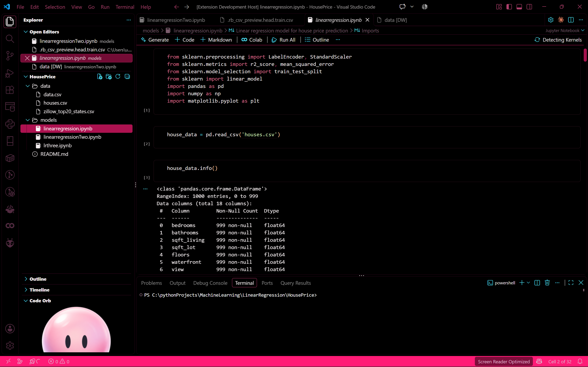

# Code Orb

A lively, frame-animated companion for your Visual Studio Code workspace.

Code Orb turns the Explorer sidebar into a tiny stage for a curious animated character made from 48 locally rendered PNG frames. It follows your activity, reacts to typing and errors, celebrates successful work, looks toward your pointer, wanders gently, and adapts to your current VS Code theme.



## Preview

Code Orb lives beneath the Explorer's other views and blends into both light and dark VS Code themes. Its frame-by-frame animation keeps the artwork crisp without drawing or recolouring the character in code.

## Features

- **Animated companion:** More than 48 frame assets with blinking, looking, hopping, sleeping, celebrating, thinking, worried, playful, and ambient animations.
- **Editor reactions:** Responds to typing, saving, diagnostics, task completion, debugging, active-editor changes, window focus, and inactivity.
- **Pointer interaction:** Looks toward the pointer in any of nine directions and reacts with a poke, bounce, or curious pose.
- **Gentle roaming:** Moves smoothly across the sidebar when roaming is enabled.
- **Theme-aware:** Uses VS Code theme variables and transparent surfaces for a native appearance.
- **Reduced-motion support:** Respects VS Code settings and the operating system's reduced-motion preference.
- **Frame-based artwork:** Every pose is sourced from pre-rendered PNG artwork in `media/frames/`.

## Installation

### From the Marketplace

Search for **Code Orb** in the Visual Studio Code Extensions view, then select **Install**.

### From a VSIX

1. Build the package with `npm run package:vsix`.
2. In VS Code, open the Extensions view.
3. Select **Views and More Actions (...) > Install from VSIX...**.
4. Choose the generated `code-orb-0.0.1.vsix` file.

## Use

Open or reveal **Code Orb** in the Explorer sidebar. It is contributed as a view rather than an Activity Bar container, so VS Code normally places it near the bottom alongside views such as Outline, Timeline, and VS Code Pets.

If another extension view is above or below it, drag Code Orb to your preferred position. VS Code remembers that placement. You can also run **Code Orb: Focus** from the Command Palette to reveal the view.

## Commands

Run these from the Command Palette (`Ctrl+Shift+P` or `Cmd+Shift+P`):

| Command | Action |
|---|---|
| **Code Orb: Focus** | Reveal the Code Orb Explorer view |
| **Code Orb: Poke** | Make Code Orb play its poke sequence |
| **Code Orb: Sleep** | Put Code Orb to sleep |
| **Code Orb: Wake** | Wake Code Orb and play its wake sequence |
| **Code Orb: Celebrate** | Play a celebration animation |

## Settings

| Setting | Default | Description |
|---|---:|---|
| `codeorb.enabled` | `true` | Enable or disable the orb view |
| `codeorb.size` | `260` | Display size in pixels, clamped to the available webview height |
| `codeorb.reduceMotion` | `false` | Limit movement to the idle frame and simple reaction crossfades |
| `codeorb.reactToTyping` | `true` | Enter a focus reaction while typing |
| `codeorb.roam` | `true` | Allow gentle horizontal roaming |
| `codeorb.idleBehaviors` | See settings UI | Choose which behaviors may play during idle animation |

## Development

Requirements: Node.js and npm.

```bash
npm install
npm run compile
npm test
npm run package:vsix
```

While developing, press `F5` to launch an Extension Development Host. Regenerate the frame manifest after changing files in `media/frames/`:

```bash
npm run build-manifest
```

## Repository

Source code, issues, and releases: [Ruvaaa/Code-Orb](https://github.com/Ruvaaa/Code-Orb)

## License

Released under the [MIT License](LICENSE).
